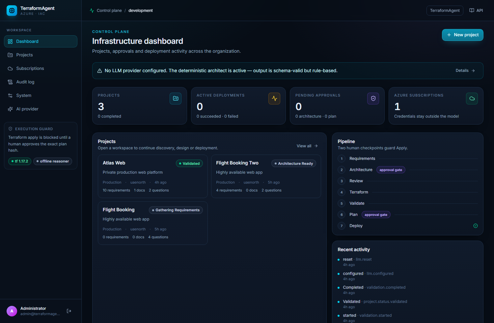
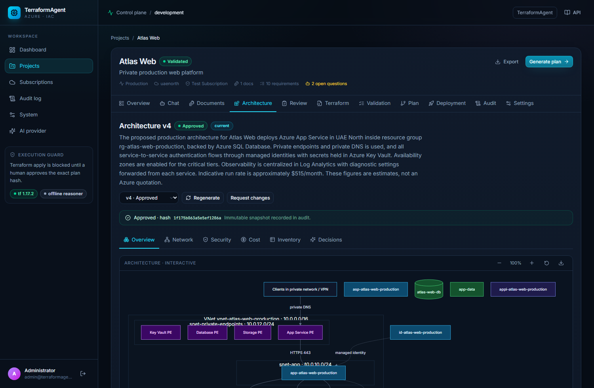
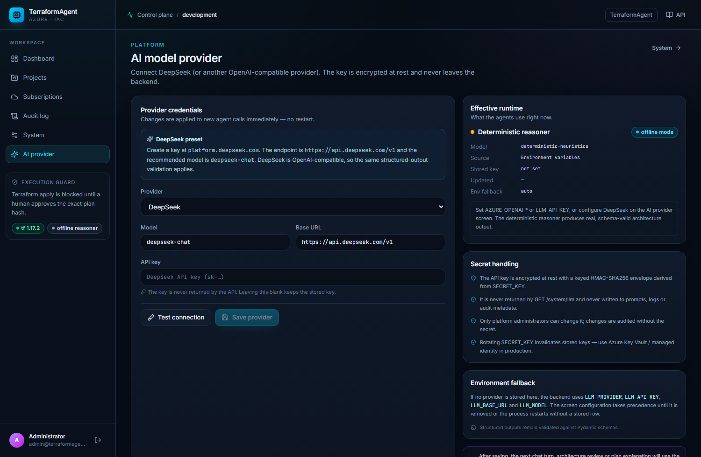
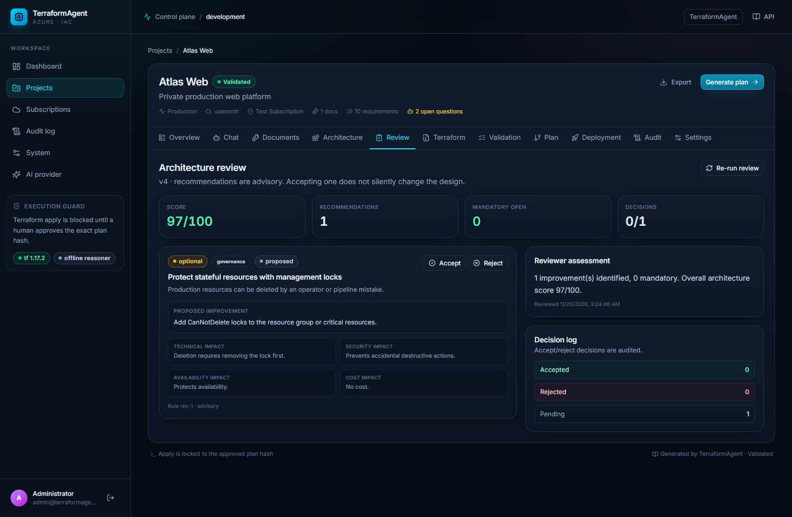
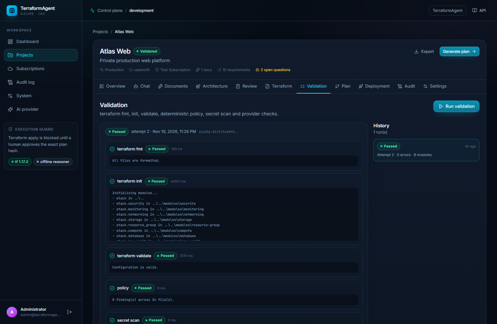

# TerraformAgent

**An AI-powered Azure infrastructure agent that designs, validates and deploys real Terraform — with human approvals enforced in code.**

Describe the workload in English or upload the architecture document. The agent interviews you,
designs the Azure platform, generates a modular Terraform project, validates it with the real
Terraform CLI, produces a hash-bound plan, and only applies the exact plan a human approved.



---

## What it does

| Stage | Capability |
|---|---|
| **Discovery** | Extracts typed requirements from conversation and documents; asks only questions that change security, cost, availability or architecture. Detects conflicts and missing information. |
| **AI provider** | Platform admins configure DeepSeek, OpenAI-compatible, Azure OpenAI or the offline reasoner at runtime. Keys are encrypted at rest, never returned by the API, and changes apply immediately. |
| **Documents** | PDF, DOCX, TXT, Markdown, XLSX, CSV, JSON, YAML and TF/HCL. Text extraction, component detection, requirement/constraint extraction, prompt-injection detection. |
| **Architecture** | Real Azure Solution Architect output: compute, VNet/subnets/NSGs, PaaS data services, Key Vault, managed identities, private endpoints/DNS, Log Analytics, HA/DR, cost and explicit decisions. |
| **Review** | Security, availability, performance, cost and governance recommendations with mandatory/optional classification, impacts and accept/reject decisions. |
| **Approval** | Versioned architecture snapshots. Approval requires a human and is bound to the canonical architecture hash. |
| **Terraform** | Deterministic, architecture-driven module composition with AzureRM provider pinning, environment separation, per-module docs and a resource→module map. |
| **Validation** | `terraform fmt -check`, `init`, `validate`, TFLint/Checkov when installed, plus a built-in deterministic policy engine and secret scanner. Critical controls cannot be disabled. A bounded (≤3) AI repair workflow proposes fixes to existing `.tf` files; the validator and policy engine still decide. |
| **Plan** | Real `terraform plan` against the target subscription; JSON plan parsing, destructive-operation classification and an AI/human-readable explanation. |
| **Deployment** | Approval tied to plan hash + source digest + architecture version + subscription + environment. Apply executes the exact saved `.tfplan`; staleness preflight refuses a changed change-set. |
| **Verification** | Read-only ARM checks of deployed resources, verification report, audit trail and deployment results. |

---

## The workflow

```
Requirement gathering → Architecture design → Architecture review
      → human approval → Terraform generation → Validation
      → Terraform plan → human plan approval → apply exact plan
      → Azure verification → Completed
```

Two checkpoints are **human-only** and enforced by the backend:

1. **Architecture approval** — bound to `sha256(canonical architecture JSON)`.
2. **Deployment approval** — bound to the binary plan hash, source digest, architecture version,
   Azure subscription and environment.

If code, architecture, requirements, subscription or plan changes, the relevant approval is
invalidated automatically.

---

## Quick start (Docker)

```bash
cp .env.example .env
# set SECRET_KEY and BOOTSTRAP_PASSWORD in .env (or export them)
docker compose up --build
```

Open <http://localhost:8010> and sign in with `BOOTSTRAP_EMAIL` / `BOOTSTRAP_PASSWORD`
(defaults: `admin@terraformagent.local` / `ChangeMe123!` — change them).

To use DeepSeek, open **AI provider** in the sidebar, paste the key and save. The key is
encrypted at rest, never returned by the API, and applied to new agent calls immediately.
Alternatively set `LLM_PROVIDER=deepseek`, `LLM_API_KEY` and `LLM_MODEL=deepseek-chat` on the
worker; the UI configuration takes precedence.

The container includes Terraform 1.17.2, runs as a non-root user with a read-only root
filesystem and dropped capabilities. PostgreSQL stores metadata; generated artifacts, plans and
logs live in the `terraformagent-data` volume.

## Local development

Prerequisites: Python 3.11+, Node 20+, Terraform 1.6+, and (for PostgreSQL) a database URL.
SQLite is supported for local development.

```bash
# Backend
cd backend
python -m venv .venv
.venv/Scripts/python -m pip install -r requirements.txt          # Windows
# source .venv/bin/activate && pip install -r requirements.txt   # Linux/macOS
cp ../.env.example .env                                          # adjust paths/secret
.venv/Scripts/python -m uvicorn app.main:app --port 8010

# Frontend (second terminal)
cd frontend
npm install
npm run dev        # http://localhost:5173, proxies /api to :8010
```

Build the SPA into the backend:

```bash
cd frontend && npm run build     # served by FastAPI at http://127.0.0.1:8010
```

### Database migrations

```bash
cd backend
python -m alembic upgrade head
```

The app also creates tables on startup for an empty development database.

---

## Configuration

All settings are environment variables (see `.env.example`). Important ones:

| Variable | Purpose |
|---|---|
| `DATABASE_URL` | `sqlite:///...` for dev, `postgresql+psycopg://...` for production |
| `SECRET_KEY` | JWT signing key — replace in production |
| `BOOTSTRAP_EMAIL` / `BOOTSTRAP_PASSWORD` | First local administrator (created only when the DB has no users) |
| `PLATFORM_ADMIN_EMAILS` | Extra emails allowed to configure the LLM provider (comma-separated) |
| `LLM_PROVIDER` | `auto`, `azure_openai`, `openai`, `deepseek`, `offline` |
| `LLM_MODEL`, `LLM_BASE_URL`, `LLM_API_KEY` | OpenAI-compatible provider |
| `AZURE_OPENAI_*` | Azure OpenAI endpoint/deployment |
| `TERRAFORM_BINARY` | Path to Terraform CLI |
| `LIVE_PRICING` | Query the public Azure Retail Prices API for current SKUs |
| `ARM_*` | Azure credentials for Terraform plans/applies (worker only) |

### AI providers

The LLM layer is provider-agnostic and validates every response against a Pydantic schema.
DeepSeek can be configured at runtime from **AI provider** (encrypted key, connection test) or
through the environment. When no provider is configured, a **deterministic Azure architect**
runs instead: real rules, real Terraform, real policy checks, conservative cost catalog. The UI
and `/api/v1/system/info` show which mode is active. The deterministic mode is not a mock — it
produces the same artifacts through a non-model reasoning path.

The model never receives Azure credentials, Terraform state, secrets or private keys. It cannot
approve, deploy, execute commands or disable policy checks.

---

## Generated Terraform

```
terraform-project/
├── README.md                     # prerequisites, auth, plan/apply/destroy, troubleshooting
├── versions.tf                   # Terraform + provider pins
├── main.tf                       # module composition
├── variables.tf / locals.tf
├── outputs.tf
├── modules/
│   ├── resource-group/
│   ├── networking/               # VNet, subnets, NSGs, NAT, private DNS
│   ├── compute/                  # VM / App Service / AKS + App Gateway
│   ├── database/                 # Azure SQL / PostgreSQL / MySQL
│   ├── storage/                  # hardened StorageV2 + private endpoint
│   ├── key-vault/                # RBAC, secrets, private endpoint
│   ├── monitoring/               # Log Analytics, App Insights, diagnostics
│   └── security/                 # scopes, role assignments, locks
├── environments/<env>/
│   ├── versions.tf / providers.tf
│   ├── main.tf                   # calls the root stack module
│   ├── variables.tf / outputs.tf
│   ├── terraform.tfvars
│   └── backend.hcl               # Azure Blob state (local by default)
└── scripts/
    ├── validate.sh / validate.ps1
    └── deploy.sh / deploy.ps1
```

Only modules required by the architecture are generated. All generated projects are formatted
with `terraform fmt`, pass `terraform validate`, and are gated by the built-in policy engine.
Every project is downloadable as a ZIP and editable in the Monaco-based code viewer. Manual edits
create an immutable new version and invalidate approvals.

---

## Security model

- **Terraform is the only mutation path.** No Azure write SDK calls exist in the codebase.
- **Two human approvals**, enforced by backend logic, not prompts.
- **Apply runs the exact approved binary plan.** SHA-256 is re-verified immediately before apply.
- **Staleness preflight** re-plans with `-refresh=false`; if the change set differs, apply is
  refused and the approval is invalidated.
- **Credentials stay in the worker.** Terraform subprocesses receive an allow-listed environment;
  logs are redacted; state never enters the database or prompts.
- **Untrusted inputs are fenced.** Documents are labelled as data; injection attempts are detected
  and surfaced. Uploaded files are size/extension validated.
- **Policy cannot be bypassed by the model.** Critical rules (public storage/database, open
  SSH/RDP, hardcoded secrets) are non-disableable.
- **Audit is append-only.** Every action, artifact hash, approval and deployment is recorded.

See [docs/architecture.md](docs/architecture.md) for the full threat model and execution design.

---

## Testing

```bash
cd backend
python -m pytest -q
```

57 tests cover:

- lifecycle state transitions and invalid transitions,
- deterministic requirement/architecture generation, CIDR overlap rejection, NSG safety,
- Terraform project generation and formatting,
- policy engine (secure/insecure HCL, variable resolution, secret scanning, non-disableable rules),
- plan parsing and destructive classification,
- approval hash binding (plan/source/subscription/architecture mismatches),
- password/JWT/redaction and execution-environment allow-listing,
- end-to-end API workflow: register → document upload → chat → architecture → review →
  approval → Terraform generation → real CLI validation.

The end-to-end test requires the Terraform CLI; it skips cleanly when Terraform is absent.

---

## API

OpenAPI at `/api/docs`. The contract is documented in [docs/api.md](docs/api.md);
data model in [docs/database.md](docs/database.md); design and roadmap in
[docs/architecture.md](docs/architecture.md) and [docs/roadmap.md](docs/roadmap.md).

Server-sent events: `GET /api/v1/projects/{id}/events?token=…` streams project status, validation,
plan, deployment and log events.

---

## Screenshots

| Architecture | AI provider |
|---|---|
|  |  |

| Review | Validation |
|---|---|
|  |  |

---

## Repository layout

```
backend/
  app/
    agents/        # requirement analyst, architect, reviewer, plan analyst, schemas
    api/           # FastAPI routers and auth dependencies
    core/          # JWT/passwords, state machine, append-only audit, errors
    llm/           # provider abstraction (Azure OpenAI / OpenAI-compatible / offline)
    services/      # orchestration, projects, documents, approvals, execution, audit
    terraform/     # HCL templates, generator, executor, validator, policy, plan parser
  migrations/      # Alembic baseline
  tests/
frontend/          # React + TypeScript + Vite + Tailwind workspace UI
deploy/            # Docker image and entrypoint
docs/              # specification, architecture, database, API, roadmap, screenshots
```

---

## Current limitations

- **Terraform apply requires real Azure credentials.** The app fails closed with the CLI error if
  the worker cannot authenticate; it never simulates a deployment.
- **One environment per project** is generated. The architecture supports multi-environment
  extension; separate state keys and backend configs are already modelled.
- **Legacy `.doc`** must be converted to `.docx`/PDF; extraction fails with a clear message.
- **TFLint and Checkov** run when installed; the built-in deterministic policy engine always runs
  as the security gate.
- **AI repair** requires an LLM provider. Without one, users fix files in the editor and re-run
  validation; the loop is capped at three attempts and every repair creates a new immutable
  Terraform version.
- **Live pricing** is best-effort (public Azure Retail Prices API) and always labelled as
  indicative, not a quotation.
- **Bootstrap state backend** (creating the state storage account) is not automated; configure an
  existing Azure Blob backend in project settings for shared/production use.
- **Import/drift** workflows are designed for in the execution layer but not exposed yet.

See [docs/roadmap.md](docs/roadmap.md) for the phased plan and extension points (AWS/GCP,
import, drift, scheduled plans).
